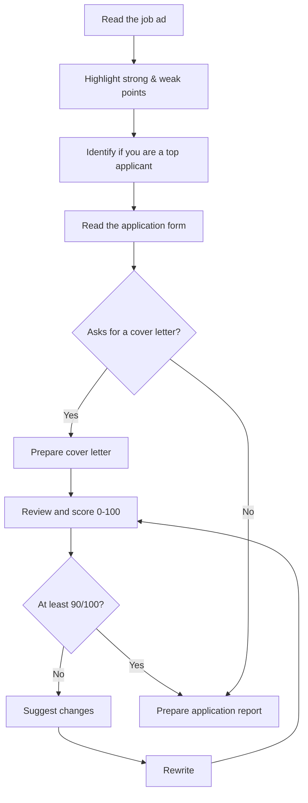

# Ieakaso

Ieakaso helps professionals find jobs that truly fit where they want their career to go next: not just any opening, the right one.
It tracks applications from first listing to offer, so nothing slips through, and guides you through interview prep along the way.

## How it works

Paste a job ad, as a URL or as text. Is it a match for you? Would you be a top applicant?

1. **You paste the job ad** in the prompt: its URL, or its text when the page is behind a login.
2. **It tells you if you are a top applicant**, after weighing your CV against what the job ad asks for, and points out the job ad's own strong and weak points.
3. **It tells you what is next**: what the application form asks for and what you need to apply.
4. **It hands you two drafts**: a cover letter (when the form asks for one) and an application report.

You read them. You send them.

## Two agents, one review loop

Ieakaso runs two agents with opposite jobs:

- **Applicant Agent** writes. It reads the job ad and the application form, drafts the cover letter, rewrites it, and prepares the application report.
- **Seasoned Recruiter** judges. It highlights the strong and weak points of the job ad, decides whether you are a top applicant, and gives every cover letter a Review score from 0 to 100.

A cover letter reaches you once the Recruiter scores it at least 90/100, declares a plateau (no change backed by your files would raise the score), or 5 rounds have run. Below 90, the Recruiter suggests changes and the Applicant rewrites.



## Getting started

Ieakaso runs locally inside a coding-assistant CLI: [Claude Code](https://claude.com/claude-code) or [OpenCode](https://opencode.ai).

On first launch it asks for your memory, in chat. Nothing to configure by hand:

- your CV
- who you are as a professional
- your most important projects
- your biggest achievements
- a personal SWOT

You run Ieakaso as `/ieakaso <mode>`. You can also pick the mode from the `/` menu: type `/ieakaso:` in Claude Code or `/ieakaso-` in OpenCode. In Claude Code, start it from the repo root. Plain `/ieakaso` asks which mode to run.

To set up, put your CV in `input/documents/cv/` and run:

```
/ieakaso init
```

It checks your documents, strongly recommends your LinkedIn "Save to PDF" export (`input/documents/linkedin/`), suggests reference letters (`input/documents/reference_letters/`), and asks you to confirm your details, target positions, and search location. It saves them in `config.yml`. Run it again any time to review or update them. Other modes run it for you if setup is incomplete.

Init also turns your CV into `input/cv.md`, word for word: nothing reworded, added, or left out. When you change your CV, the next mode you run updates `input/cv.md` for you, or run it yourself:

```
/ieakaso cv-parser
```

Edit your CV, not `input/cv.md`: it is regenerated from the CV.

Then ask whether a job ad is worth applying to. Give its URL, or paste its text:

```
/ieakaso job-analyzer <job-url or job-ad text>
```

It answers in chat with a verdict, a score out of 100, the reason, and your top three strengths and weaknesses for the role. The full job analysis is saved as `output/job-analysis/<company>_<position>_<yyyymmdd>.md`.

| Score | Verdict | Advice |
|---|---|---|
| 90-100 | Top applicant | Apply, leading with your strongest matches |
| 80-89 | Apply | Apply, and close the gaps in your cover letter |
| 60-79 | Stretch | Don't apply; it says why |
| 0-59 | Don't apply | Don't apply; it names the deciding gap |

The advice is yours to override. A missing must-have, like a required work permit or language, caps the score at 59.

The score reads only your CV, as a recruiter would. Your other memory files never raise it: they show what your CV under-sells, with wording you can add to your CV to score higher next time. If the URL can't be read, it asks you to paste the ad. Running it again for the same company and position on the same day replaces that day's analysis.

When the job is worth it, write the cover letter:

```
/ieakaso cover-letter [<job-url or job-ad text>]
```

Without an argument it uses the last job ad of the session, or asks. It runs the job analysis first if there is none for that ad. Then the Applicant drafts the letter and the Recruiter reviews it, round after round, until the score is 90/100, the Recruiter sees no way to raise it from your files, or 5 rounds have run. The final letter is saved as `output/cover-letter/<company>_<position>_<yyyymmdd>.md` (one A4 page, body of at most 350 words) and every round's draft and review as `..._review.md`. Facts you only tell it in chat are never used: add them to your files and it runs another round.

The first runs are rough. It does not know you yet.
Talk to it: what you want, what you refuse.
Think of it as a recruiter's first week.

## Token usage

Ieakaso shows the Token usage of each Run, in Claude Code. A **Run** is one `/ieakaso <mode>` call, including the setup it triggers and your follow-up questions about its result. A Run's Token usage includes that of its **Agent runs**, the calls to the Applicant Agent and the Seasoned Recruiter. When a mode finishes, even when it stops early, it prints a summary of the Run so far:

```
── Ieakaso · job-analyzer (so far) ───────────────
Model     claude-opus-5-5
Tokens    in 12.4k · out 3.1k · cache read 48.0k
Context   84k / 200k (42%)
  Agent run  recruiter (claude-sonnet-5-5)   in 4.0k · out 0.8k · cache read 9.0k
Session   3 Runs · in 31.0k · out 7.9k · cache read 120k
```

It lists the models used, the Token usage (input includes cache writes), the Context fill, one line per Agent run and the total for the Session: the Runs since you started or cleared Claude Code. Other activity in the Session is not counted. It shows tokens only, never a price, and nothing is saved: it is read from the Claude Code transcript each time.

The status line at the bottom of Claude Code shows the same, live: `opus-5-5 · ctx 42%` before any Run, and `ieakaso ▸ job-analyzer · opus-5-5 · ctx 42% · run 15.5k new · session 39k new` after. "new" is input plus output, without cache reads. It is set in `.claude/settings.json`.

## Your data

Every application lives on your machine, as Markdown files in a plain folder tree. An application's status is the folder it sits in:

```
applications/
├── applied/
├── interviewing/
├── offer/
└── not-selected/
```

An application moves from `applied` to `interviewing` to `offer`, or to `not-selected` at either stage.

Ieakaso learns from every application it follows and folds what it learns back into its memory of you. Your data leaves your machine only to reach the AI provider you chose.

## What Ieakaso will not do

- **Submit an application.** It drafts; you review and click Submit.
- **Send or check emails.** Drafts only. You paste them in your email client, you send.
- **Invent your CV.** It reformulates your experience; it never fabricates it. Read every draft before you send it.

## Roadmap

- **Interview prep flow.** Guidance from first call to offer.
- **Still open?** Check that a job ad is still live, and spot reposts, before you write a word.
- **Richer fit score.** Score the position against your LinkedIn profile too. You can override the score.
- **CV and form answers.** Rewrite the CV for each job ad and draft answers for every field of the application form.
- **Who do I talk to?** Find the hiring manager or recruiter and draft a note. It never sends it.
- **What should I learn?** After a run of rejections, name the gap.
- **OpenCode usage.** The token summary and status line, in OpenCode too.
- **`/ieakaso usage`.** A mode to ask for the usage on demand.
- **Fabrication check.** Block any CV draft whose facts or numbers are not in your memory.

## License

[AGPL-3.0](LICENSE)
